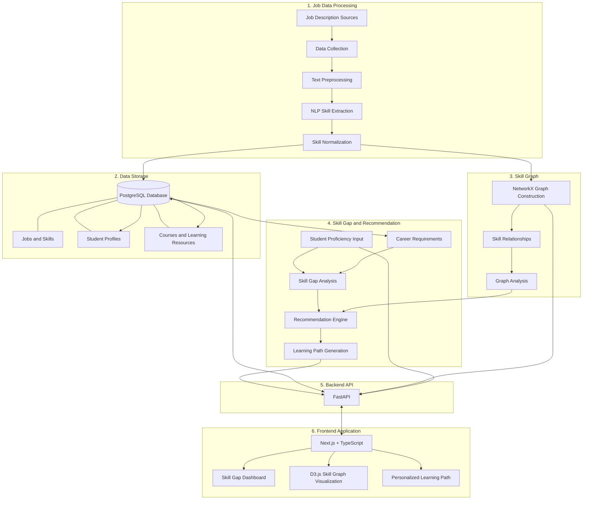

# SkillGraph — System Architecture

## 1. Overview

SkillGraph is an explainable skill relationship graph system designed to analyze the skill requirements of job descriptions, identify student skill gaps, and recommend personalized learning pathways.

The system consists of two main workflows:

- **Data Processing Workflow:** Collects job descriptions, extracts and normalizes skills, and constructs the skill relationship graph.
- **Student Recommendation Workflow:** Accepts student proficiency information, analyzes skill gaps, and generates personalized learning recommendations.

## 2. System Architecture Diagram

## 3. Main System Components

| Component | Technology | Responsibility |
|---|---|---|
| Data Collection | Python | Collect job descriptions |
| Text Preprocessing | Python, Pandas | Clean and prepare job description text |
| Skill Extraction | spaCy, Sentence Transformers | Extract relevant skills |
| Skill Normalization | Python, NLP | Standardize skill names |
| Database | PostgreSQL | Store jobs, skills, students, and courses |
| Graph Construction | NetworkX | Build and analyze skill relationships |
| Skill Gap Analysis | Python | Compare student proficiency with career requirements |
| Recommendation Engine | Python | Prioritize skills and recommend learning paths |
| Backend API | FastAPI | Connect the frontend with system functionality |
| Frontend | Next.js, TypeScript | Provide the user interface |
| Graph Visualization | D3.js | Display skill relationships visually |

## 4. Main Data Flow

### A. Job Data Processing

1. Collect English job descriptions.
2. Preprocess and clean the text.
3. Extract skills using NLP techniques.
4. Normalize extracted skill names.
5. Store job descriptions and skill information in PostgreSQL.
6. Construct skill relationships using NetworkX.

### B. Student Recommendation

1. Student selects a target career.
2. Student enters proficiency levels for relevant skills.
3. System retrieves the required skills for the selected career.
4. Skill gap analysis identifies missing or insufficient skills.
5. Recommendation engine considers skill importance and relationships.
6. System generates an ordered learning pathway.
7. Results are delivered through FastAPI and displayed in the frontend.

## 5. Technology Stack & Implementation Status (Week 3 Audit)

| Component | Target Stack | Current Repository Status |
| :--- | :--- | :--- |
| **Core Language & Analytics** | Python 3.12, Pandas, NumPy, scikit-learn | **Implemented & Tested** (`.venv` active) |
| **NLP Extraction & Negation** | spaCy (`en_core_web_sm` parser), regex clause rules | **Implemented & Tested** (`DictionarySkillExtractor`, `SpacySkillExtractor`) |
| **Knowledge Graph Engine** | Python adjacency engine + optional NetworkX (`to_networkx()`) | **Implemented & Tested** (`2,336` nodes, `31,503` edges; `networkx` optional/not installed in `.venv`) |
| **Skill Gap, Priority & Explanations** | `SkillGapAnalysisEngine`, `PriorityScoringModel`, `MultiOccupationAnalyzer`, `LearningPathRecommender` | **Implemented & Tested** (`P(s) = G(s), O(s)`; `D(s), C(s)` safely disabled when absent) |
| **Backend REST API** | FastAPI + Pydantic v2 + Uvicorn (`backend/app/main.py`) | **Implemented & Tested** (Native `FastAPI` when installed; pure-Python ASGI 3.0 + Pydantic v2 + OpenAPI `3.1.0` fallback `SkillGraphASGIApp` active in `.venv`) |
| **Database Persistence** | PostgreSQL 17 (`get_postgresql_ddl()`) + SQLite mirror (`PRAGMA foreign_keys = ON`) | **Implemented & Tested** (`17`-table schema; local PG 17 accepting TCP on `127.0.0.1:5432`, awaiting `.env` password & driver install for live PG) |
| **University Syllabi & Student UI** | Next.js / TypeScript / Real Course Catalog | **Proposed / Awaiting data** (Tables `university_majors`, `university_courses`, `course_skills` = `0` rows; no frontend files built) |

## 6. Design Considerations

- Keep job data processing separate from student recommendation functionality.
- Use PostgreSQL as the persistent relational target with an offline constraint-enforced SQLite mirror for reproducible offline execution.
- Represent market skill co-occurrence (`CO_OCCURS_WITH`) without misinterpreting co-occurrence as prerequisite ordering (`PREREQUISITE_OF`).
- Keep every recommendation explainable with 7-part structured evidence, numerical formulas (`G(s)`, `O(s)`, `P(s)`), weight sensitivity checks, and explicit notices where human validation (`human_annotation_sample_50.json`: `PENDING`) or curriculum data (`UNAVAILABLE_NO_VERIFIED_COURSE_CATALOG`) is absent.
- Design the backend API (`docs/api/api_documentation.md`) cleanly behind `DatabaseLayer` and `SkillGapService` so UI or PostgreSQL drivers attach via environment configuration (`.env.example`, `docker-compose.yml`).

## 7. Conclusion

As of Week 3, SkillGraph implements and tests end-to-end dependency-based negation filtering, explainable skill gap analysis, multi-occupation career opportunity scoring, weight-sensitivity reporting, 17-table relational persistence, and OpenAPI 3.1 REST endpoints—while explicitly preserving boundaries around synthetic training data, pending human annotation review, and awaiting real university curriculum data.
