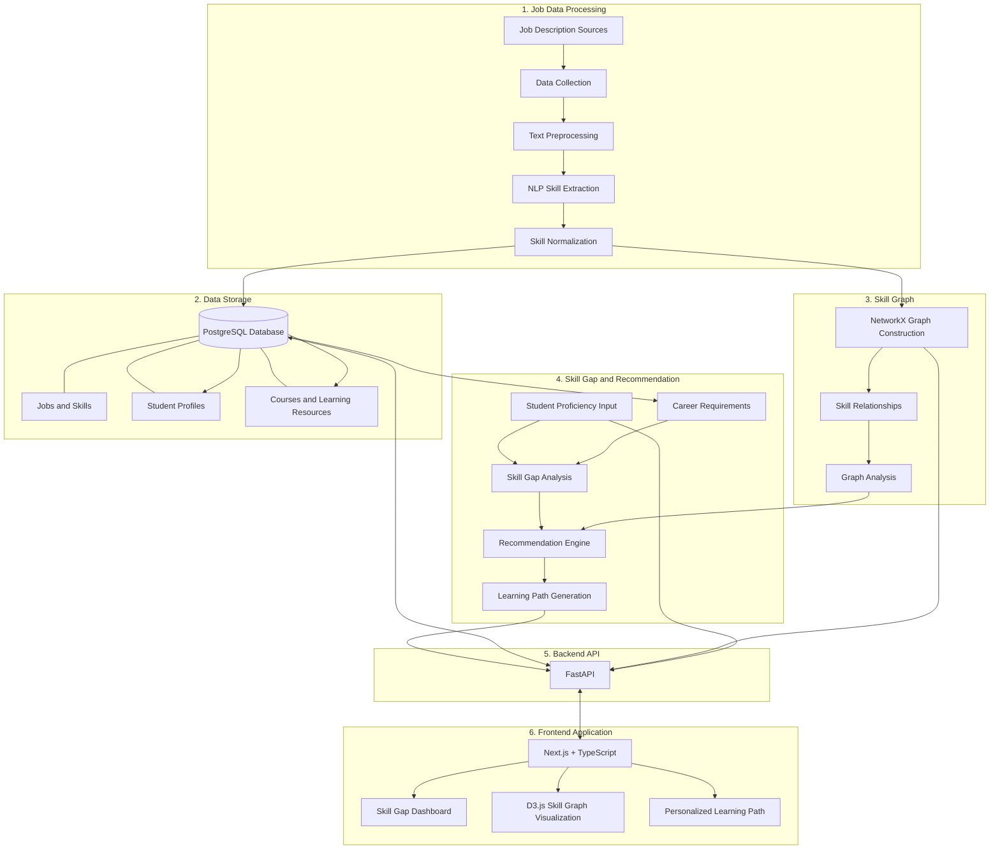

# SkillGraph — System Architecture

## 1. Overview

SkillGraph is an explainable skill relationship graph system designed to analyze the skill requirements of job descriptions, identify student skill gaps, and recommend personalized learning pathways.

The system consists of two main workflows:

- **Data Processing Workflow:** Collects job descriptions, extracts and normalizes skills, and constructs the skill relationship graph.
- **Student Recommendation Workflow:** Accepts student proficiency information, analyzes skill gaps, and generates personalized learning recommendations.

## 2. System Architecture Diagram

## 3. Main System Components

| Component | Technology | Responsibility |
|---|---|---|
| Data Collection | Python | Collect job descriptions |
| Text Preprocessing | Python, Pandas | Clean and prepare job description text |
| Skill Extraction | spaCy, Sentence Transformers | Extract relevant skills |
| Skill Normalization | Python, NLP | Standardize skill names |
| Database | PostgreSQL | Store jobs, skills, students, and courses |
| Graph Construction | NetworkX | Build and analyze skill relationships |
| Skill Gap Analysis | Python | Compare student proficiency with career requirements |
| Recommendation Engine | Python | Prioritize skills and recommend learning paths |
| Backend API | FastAPI | Connect the frontend with system functionality |
| Frontend | Next.js, TypeScript | Provide the user interface |
| Graph Visualization | D3.js | Display skill relationships visually |

## 4. Main Data Flow

### A. Job Data Processing

1. Collect English job descriptions.
2. Preprocess and clean the text.
3. Extract skills using NLP techniques.
4. Normalize extracted skill names.
5. Store job descriptions and skill information in PostgreSQL.
6. Construct skill relationships using NetworkX.

### B. Student Recommendation

1. Student selects a target career.
2. Student enters proficiency levels for relevant skills.
3. System retrieves the required skills for the selected career.
4. Skill gap analysis identifies missing or insufficient skills.
5. Recommendation engine considers skill importance and relationships.
6. System generates an ordered learning pathway.
7. Results are delivered through FastAPI and displayed in the frontend.

## 5. Proposed Technology Stack

- **Programming Language:** Python
- **Backend:** FastAPI
- **Database:** PostgreSQL
- **Graph Processing:** NetworkX
- **NLP:** spaCy, Sentence Transformers
- **Data Processing:** Pandas, NumPy
- **Machine Learning and Analysis:** scikit-learn, SciPy, Statsmodels
- **Frontend:** Next.js, TypeScript, Tailwind CSS
- **Visualization:** D3.js
- **Development and Deployment:** Jupyter Notebook, Docker

## 6. Design Considerations

- Keep job data processing separate from student recommendation functionality.
- Use PostgreSQL as the persistent data storage layer.
- Use NetworkX for skill relationship representation and graph analysis.
- Keep the recommendation process explainable by showing why a skill is recommended.
- Design the backend API so the frontend can access system functionality independently.
- Allow the architecture to be extended when additional occupations, skills, and learning resources are added.

## 7. Conclusion

The proposed architecture connects job market information, NLP-based skill extraction, skill relationship graph analysis, student proficiency assessment, and personalized learning recommendations.

It provides the technical foundation for developing SkillGraph as an explainable career skill-gap analysis and learning pathway recommendation system.
