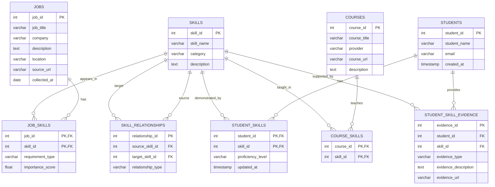

# SkillGraph — Database ER Diagram

## 1. Overview

The SkillGraph database is designed using PostgreSQL to store job information, standardized skills, student competency profiles, and learning resources.

The database uses relational tables and foreign keys to represent connections between entities. Connecting tables are used to handle many-to-many relationships.

## 2. Entity Relationship Diagram

## 3. Table Descriptions

### 3.1 jobs

Stores information about collected job descriptions.

| Column | Type | Description |
|---|---|---|
| job_id | INT, PK | Unique job identifier |
| job_title | VARCHAR | Job title |
| company | VARCHAR | Company name |
| description | TEXT | Full job description |
| location | VARCHAR | Job location |
| source_url | VARCHAR | Original source |
| collected_at | DATE | Collection date |

### 3.2 skills

Stores standardized skill entities after extraction and normalization.

| Column | Type | Description |
|---|---|---|
| skill_id | INT, PK | Unique skill identifier |
| skill_name | VARCHAR | Standardized skill name |
| category | VARCHAR | Skill category |
| description | TEXT | Skill description |

Examples: Python, SQL, Data Visualization, Machine Learning.

### 3.3 students

Stores student profile information.

| Column | Type | Description |
|---|---|---|
| student_id | INT, PK | Unique student identifier |
| student_name | VARCHAR | Student name |
| email | VARCHAR | Student email |
| created_at | TIMESTAMP | Profile creation time |

### 3.4 courses

Stores courses and learning resources.

| Column | Type | Description |
|---|---|---|
| course_id | INT, PK | Unique course identifier |
| course_title | VARCHAR | Course title |
| provider | VARCHAR | Learning platform or provider |
| course_url | VARCHAR | Course URL |
| description | TEXT | Course description |

### 3.5 job_skills

Connects jobs with their required or preferred skills.

| Column | Type | Description |
|---|---|---|
| job_id | INT, PK, FK | References jobs |
| skill_id | INT, PK, FK | References skills |
| requirement_type | VARCHAR | Required or preferred |
| importance_score | FLOAT | Skill importance score, if available |

This table represents the many-to-many relationship between jobs and skills.

### 3.6 student_skills

Connects students with their current skills and proficiency levels.

| Column | Type | Description |
|---|---|---|
| student_id | INT, PK, FK | References students |
| skill_id | INT, PK, FK | References skills |
| proficiency_level | VARCHAR | Beginner, Intermediate, Advanced, or Proficient |
| updated_at | TIMESTAMP | Last update time |

### 3.7 skill_relationships

Stores relationships between two skills for knowledge graph construction.

| Column | Type | Description |
|---|---|---|
| relationship_id | INT, PK | Unique relationship identifier |
| source_skill_id | INT, FK | Starting skill |
| target_skill_id | INT, FK | Related or destination skill |
| relationship_type | VARCHAR | Relationship type |

Examples:
- Python → RELATED_TO → Data Analysis
- Statistics → PREREQUISITE_OF → Machine Learning

### 3.8 course_skills

Connects courses with the skills they teach.

| Column | Type | Description |
|---|---|---|
| course_id | INT, PK, FK | References courses |
| skill_id | INT, PK, FK | References skills |

### 3.9 student_skill_evidence

Stores supporting evidence for a student's claimed skills.

| Column | Type | Description |
|---|---|---|
| evidence_id | INT, PK | Unique evidence identifier |
| student_id | INT, FK | References students |
| skill_id | INT, FK | References skills |
| evidence_type | VARCHAR | Project, certificate, or other evidence |
| evidence_description | TEXT | Evidence details |
| evidence_url | VARCHAR | Link to supporting evidence |

## 4. Relationship Summary

| Relationship | Database Representation |
|---|---|
| Job — Skill | job_skills |
| Student — Skill | student_skills |
| Skill — Skill | skill_relationships |
| Course — Skill | course_skills |
| Student — Skill Evidence | student_skill_evidence |

The proposed schema supports the main project entities and relationships while keeping the database organized and extensible.

## 5. Design Considerations

- Use primary keys to uniquely identify records.
- Use foreign keys to maintain referential integrity.
- Use connecting tables to represent many-to-many relationships.
- Store standardized skill names in the skills table to avoid inconsistent skill records.
- Store student proficiency separately from the skill definition.
- Keep supporting evidence associated with the relevant student and skill.
- Validate relationship types and proficiency values before implementation.

## 6. Conclusion

This proposed ER design provides a relational foundation for SkillGraph. It supports job skill requirements, student competency profiles, skill relationships, and learning resources.

The database can later supply structured information to the NetworkX graph-processing layer and the FastAPI backend.
