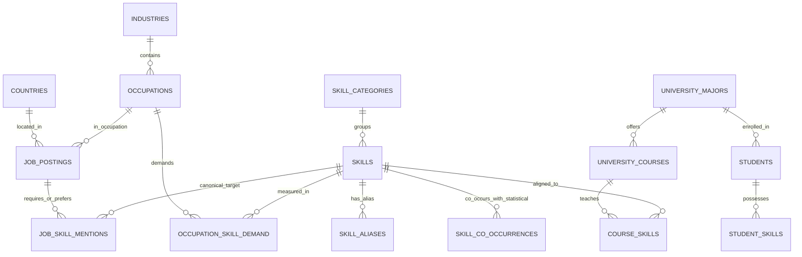

# SkillGraph — Week 2 Database & Knowledge Graph Schema Specification

**Target Engines:** PostgreSQL 15+ (Relational Persistence & FastAPI Backend) + NetworkX / Graph Projection (`scripts/build_graph.py`)  
**Status:** Week 2 Aligned with Processed CSVs & Extraction Outputs

---

## 1. Entity-Relationship Overview



---

## 2. Core Labor-Market & Taxonomy DDL (PostgreSQL)

```sql
-- Reference Taxonomies
CREATE TABLE skill_categories (
    category_id       VARCHAR(64) PRIMARY KEY,
    category_name     VARCHAR(128) NOT NULL UNIQUE,
    skill_count       INTEGER NOT NULL DEFAULT 0
);

CREATE TABLE skills (
    skill_id          VARCHAR(32) PRIMARY KEY,      -- e.g., SG-SK-0001 .. SG-SK-0230
    canonical_skill   VARCHAR(256) NOT NULL UNIQUE,
    category_id       VARCHAR(64) NOT NULL REFERENCES skill_categories(category_id),
    skill_type        VARCHAR(64) NOT NULL,         -- Technology, Tool, Hard skill, Soft skill, etc.
    taxonomy_source   VARCHAR(64) NOT NULL,         -- SKILLGRAPH_LOCAL_V1
    esco_uri          TEXT,                         -- Nullable until external ESCO alignment
    onet_element_id   VARCHAR(64),                  -- Nullable until external O*NET alignment
    mapping_status    VARCHAR(64) NOT NULL
);

CREATE TABLE skill_aliases (
    alias_id          SERIAL PRIMARY KEY,
    skill_id          VARCHAR(32) NOT NULL REFERENCES skills(skill_id) ON DELETE CASCADE,
    alias_text        VARCHAR(256) NOT NULL,
    case_sensitive    BOOLEAN NOT NULL DEFAULT FALSE,
    UNIQUE (skill_id, alias_text)
);

CREATE TABLE industries (
    industry_id       VARCHAR(64) PRIMARY KEY,
    industry_name     VARCHAR(128) NOT NULL UNIQUE,
    occupation_count  INTEGER NOT NULL DEFAULT 0
);

CREATE TABLE occupations (
    occupation_id         VARCHAR(32) PRIMARY KEY,  -- e.g., SG-OCC-0001 .. SG-OCC-0053
    occupation            VARCHAR(256) NOT NULL UNIQUE,
    industry_id           VARCHAR(64) NOT NULL REFERENCES industries(industry_id),
    department_label      VARCHAR(128),
    isco08_code_candidate VARCHAR(32),
    isco08_label_candidate VARCHAR(256),
    mapping_confidence    NUMERIC(4,3),
    mapping_status        VARCHAR(64),
    esco_occupation_uri   TEXT,
    onet_soc_code         VARCHAR(32)
);

CREATE TABLE countries (
    country_code      CHAR(2) PRIMARY KEY,          -- ISO 3166-1 alpha-2
    country           VARCHAR(128) NOT NULL UNIQUE,
    region            VARCHAR(64) NOT NULL
);

CREATE TABLE job_postings (
    job_id                VARCHAR(64) PRIMARY KEY,  -- e.g., GLOBAL_SYN_000001
    occupation_id         VARCHAR(32) NOT NULL REFERENCES occupations(occupation_id),
    country_code          CHAR(2) NOT NULL REFERENCES countries(country_code),
    job_title             VARCHAR(256) NOT NULL,
    seniority_level       VARCHAR(64) NOT NULL,
    education_level       VARCHAR(64) NOT NULL,
    experience_years_min  INTEGER CHECK (experience_years_min >= 0),
    experience_years_max  INTEGER CHECK (experience_years_max >= experience_years_min),
    employment_type       VARCHAR(64) NOT NULL,
    description           TEXT NOT NULL,
    is_synthetic          BOOLEAN NOT NULL DEFAULT TRUE,
    split                 VARCHAR(32) NOT NULL      -- train | validation | test
);

-- Provenance-Preserving Extraction Edges (REQUIRES_SKILL / PREFERS_SKILL)
CREATE TABLE job_skill_mentions (
    mention_id            BIGSERIAL PRIMARY KEY,
    job_id                VARCHAR(64) NOT NULL REFERENCES job_postings(job_id) ON DELETE CASCADE,
    skill_id              VARCHAR(32) REFERENCES skills(skill_id), -- Nullable if UNRESOLVED_CANONICAL
    skill_mention         VARCHAR(256) NOT NULL,
    character_start       INTEGER NOT NULL CHECK (character_start >= 0),
    character_end         INTEGER NOT NULL CHECK (character_end > character_start),
    source_section        VARCHAR(32) NOT NULL,     -- required | preferred | responsibilities | intro_or_title
    extractor_name        VARCHAR(64) NOT NULL,     -- SpacySkillExtractor | DictionarySkillExtractor
    match_method          VARCHAR(64) NOT NULL,     -- exact_match | alias_match | context_verified_short_token | country_specific_broad_match
    mapping_status        VARCHAR(64) NOT NULL,     -- MAPPED | BROAD_COUNTRY_MAPPING | UNRESOLVED_CANONICAL
    mapping_confidence    NUMERIC(4,3) NOT NULL
);
CREATE INDEX idx_jsm_job_id ON job_skill_mentions(job_id);
CREATE INDEX idx_jsm_skill_id ON job_skill_mentions(skill_id);
CREATE INDEX idx_jsm_section ON job_skill_mentions(source_section);
```

---

## 3. Graph Projection & Statistical Tables

```sql
-- Aggregated Occupation -> Skill Market Demand Weight
CREATE TABLE occupation_skill_demand (
    occupation_id             VARCHAR(32) REFERENCES occupations(occupation_id),
    skill_id                  VARCHAR(32) REFERENCES skills(skill_id),
    job_count                 INTEGER NOT NULL,
    required_count            INTEGER NOT NULL,
    preferred_count           INTEGER NOT NULL,
    occupation_total_postings INTEGER NOT NULL,
    demand_share              NUMERIC(5,4) NOT NULL, -- job_count / occupation_total_postings
    PRIMARY KEY (occupation_id, skill_id)
);

-- Symmetric Statistical Skill Co-Occurrence (explicitly NOT prerequisite ordering)
CREATE TABLE skill_co_occurrences (
    source_skill_id           VARCHAR(32) REFERENCES skills(skill_id),
    target_skill_id           VARCHAR(32) REFERENCES skills(skill_id),
    co_occurrence_count       INTEGER NOT NULL,
    jaccard_similarity        NUMERIC(6,4) NOT NULL,
    pmi_score                 NUMERIC(8,4) NOT NULL,
    relationship_semantics    VARCHAR(64) NOT NULL DEFAULT 'statistical_co_occurrence_not_prerequisite',
    CHECK (source_skill_id < target_skill_id),
    PRIMARY KEY (source_skill_id, target_skill_id)
);
```

---

## 4. Week 3 Implemented Relational Schema (`17` Tables, `6` Indexes) & Curriculum Extension (`Implemented`)

Week 3 promotes the planned curriculum/student tables and adds persistence tables (`skill_gap_analyses`, `recommendation_explanations`) inside [scripts/build_graph.py](file:///D:/Downloads/SkillGraph/scripts/build_graph.py) (`POSTGRESQL_DDL_STATEMENTS`, `get_postgresql_ddl()`), enforced across both PostgreSQL DDL (`BIGSERIAL`, `BOOLEAN`, `TIMESTAMPTZ`, `CHECK`, `UNIQUE`, `FOREIGN KEY`) and the offline `sqlite3` mirror (`PRAGMA foreign_keys = ON`).

**PostgreSQL Host & Execution Audit (`2026-11-14`):**
- PostgreSQL 17 service is active locally (`127.0.0.1:5432 - accepting connections`), with `psql.exe` and `pg_isready.exe` present.
- Non-interactive `psql -U postgres -w -l` returned `fe_sendauth: no password supplied`, and Python PostgreSQL drivers (`psycopg2`, `psycopg`, `asyncpg`, `sqlalchemy`) are not installed in the offline `.venv` (`live_pg_execution_ready = False`).
- Accordingly, `RelationalDatabaseManager` executes all `17` tables cleanly in `sqlite3` (`PRAGMA foreign_keys = ON`), keeping `university_majors` (`0`), `university_courses` (`0`), and `course_skills` (`0`) empty (`Awaiting data`) with zero fabricated course or student rows.

```sql
CREATE TABLE IF NOT EXISTS university_majors (
    major_id          VARCHAR(64) PRIMARY KEY,
    major_name        VARCHAR(256) NOT NULL UNIQUE,
    institution_name  VARCHAR(256) NOT NULL,
    degree_level      VARCHAR(64) NOT NULL,
    data_provenance   VARCHAR(64) NOT NULL DEFAULT 'awaiting_verified_curriculum_ingestion'
);

CREATE TABLE IF NOT EXISTS university_courses (
    course_id         VARCHAR(64) PRIMARY KEY,
    course_code       VARCHAR(32) NOT NULL,
    course_title      VARCHAR(256) NOT NULL,
    major_id          VARCHAR(64) REFERENCES university_majors(major_id) ON DELETE CASCADE,
    syllabus_text     TEXT,
    data_provenance   VARCHAR(64) NOT NULL DEFAULT 'awaiting_verified_curriculum_ingestion',
    UNIQUE (major_id, course_code)
);

CREATE TABLE IF NOT EXISTS course_skills (
    course_id               VARCHAR(64) NOT NULL REFERENCES university_courses(course_id) ON DELETE CASCADE,
    skill_id                VARCHAR(32) NOT NULL REFERENCES skills(skill_id),
    extraction_method       VARCHAR(64) NOT NULL,
    target_proficiency_level VARCHAR(32),
    PRIMARY KEY (course_id, skill_id)
);

CREATE TABLE IF NOT EXISTS students (
    student_id            VARCHAR(64) PRIMARY KEY,
    major_id              VARCHAR(64) REFERENCES university_majors(major_id),
    target_occupation_id  VARCHAR(32) REFERENCES occupations(occupation_id),
    is_synthetic          BOOLEAN NOT NULL DEFAULT TRUE,
    created_at            TIMESTAMPTZ NOT NULL DEFAULT NOW()
);

CREATE TABLE IF NOT EXISTS student_skills (
    student_id         VARCHAR(64) NOT NULL REFERENCES students(student_id) ON DELETE CASCADE,
    skill_id           VARCHAR(32) NOT NULL REFERENCES skills(skill_id),
    proficiency_level  VARCHAR(32) NOT NULL,
    proficiency_score  REAL CHECK (proficiency_score IS NULL OR (proficiency_score >= 0.0 AND proficiency_score <= 1.0)),
    evidence_source    VARCHAR(128),
    PRIMARY KEY (student_id, skill_id)
);

CREATE TABLE IF NOT EXISTS skill_gap_analyses (
    analysis_id           VARCHAR(64) PRIMARY KEY,
    student_id            VARCHAR(64) NOT NULL REFERENCES students(student_id) ON DELETE CASCADE,
    target_occupation_id  VARCHAR(32) NOT NULL REFERENCES occupations(occupation_id),
    required_coverage     REAL NOT NULL CHECK (required_coverage >= 0.0 AND required_coverage <= 1.0),
    overall_coverage      REAL NOT NULL CHECK (overall_coverage >= 0.0 AND overall_coverage <= 1.0),
    skill_gap_score       REAL NOT NULL CHECK (skill_gap_score >= 0.0 AND skill_gap_score <= 1.0),
    weights_json          TEXT NOT NULL,
    payload_json          TEXT NOT NULL,
    is_synthetic          BOOLEAN NOT NULL DEFAULT TRUE,
    created_at            TIMESTAMPTZ NOT NULL DEFAULT NOW()
);

CREATE TABLE IF NOT EXISTS recommendation_explanations (
    explanation_id    BIGSERIAL PRIMARY KEY,
    analysis_id       VARCHAR(64) NOT NULL REFERENCES skill_gap_analyses(analysis_id) ON DELETE CASCADE,
    student_id        VARCHAR(64) NOT NULL REFERENCES students(student_id) ON DELETE CASCADE,
    skill_id          VARCHAR(32) NOT NULL REFERENCES skills(skill_id),
    rank_order        INTEGER NOT NULL CHECK (rank_order >= 1),
    requirement_type  VARCHAR(32) NOT NULL,
    profile_status    VARCHAR(64) NOT NULL,
    priority_score    REAL NOT NULL CHECK (priority_score >= 0.0 AND priority_score <= 1.0),
    learning_stage    VARCHAR(128) NOT NULL,
    explanation_json  TEXT NOT NULL,
    UNIQUE (analysis_id, skill_id)
);
```

---

## 5. Sample Explainable Skill-Gap & Persisted Recommendation Queries

```sql
-- Target occupation missing/partial skills ranked against demand_share
SELECT
    s.skill_id,
    s.canonical_skill,
    d.demand_share,
    d.required_count,
    d.preferred_count
FROM occupation_skill_demand d
JOIN occupations o ON o.occupation_id = d.occupation_id
JOIN skills s ON s.skill_id = d.skill_id
WHERE o.occupation = 'Data Analyst'
  AND d.skill_id NOT IN (
      SELECT skill_id FROM student_skills WHERE student_id = :student_id
  )
ORDER BY d.demand_share DESC, d.required_count DESC
LIMIT 10;

-- Retrieve ordered persisted recommendations with stored explanations
SELECT
    re.rank_order,
    s.canonical_skill,
    re.requirement_type,
    re.profile_status,
    re.priority_score,
    re.learning_stage
FROM recommendation_explanations re
JOIN skills s ON s.skill_id = re.skill_id
WHERE re.student_id = :student_id
  AND re.analysis_id = (
      SELECT analysis_id FROM skill_gap_analyses
      WHERE student_id = :student_id
      ORDER BY created_at DESC LIMIT 1
  )
ORDER BY re.rank_order ASC;
```

